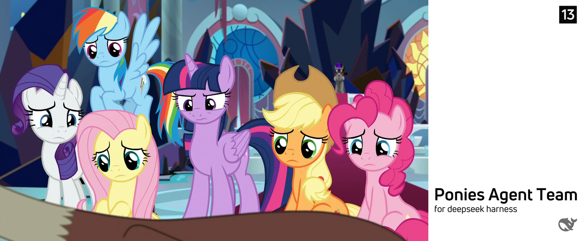

# P.A.T. - Ponies Agent Team `v1.1`

| Edition | Package | Characters | Volume | Language patches | Global Leads |
| --- | --- | ---: | ---: | ---: | ---: |
| **Plus** | `v1.1-plus-95c`| **95** | 7| 19 | 7 |
| **Lite** | `v1.1-lite-18c` | **18** | 2| 9 | 5 |




---

## Table of contents / 目录

- [Overview / 总览](#overview--总览)
- [Edition comparison / 版本对比](#edition-comparison--版本对比)
- [Quick start / 快速开始](#quick-start--快速开始)
- [Repository layout / 仓库结构](#repository-layout--仓库结构)
- [Language patches / 语言与方言](#language-patches--语言与方言)
- [Global Leads / 全局主 Lead](#global-leads--全局主-lead)
- [Version & fan notice / 版本与同人声明](#version--fan-notice--版本与同人声明)
- [中文说明](#中文说明)
- [Generated by](#-generated-by)

---

## Overview / 总览

**Ponies Agent Team (P.A.T.)** is a data package for AI roleplay sessions. It documents My Little Pony
characters with 17 complete personal-characteristic fields each, splits them into equal-sized
storage "volume" teams so that an Agent-Teams-capable AI can hold the whole cast across several
members, and ships an operator flow (`RUN.md`) that turns any AI session into a coordinated MLP
roleplay team — with language/dialect patches and a selectable global Lead.

This repository contains **two editions of the same dataset**:

- **`ponies-agent-team-v1.1-plus-95c`** — the full edition: **95 characters** (G4/EG 84 + G5 11)
  in **7 volume teams T0–T6**, 19 language patches, 7 global Leads, ~79,600 words of profiles.
- **`ponies-agent-team-v1.1-lite-18c`** — the compact edition: **18 characters** taken verbatim
  from the full edition (G4/EG 12 + G5 6) in **2 volume teams T0–T1**, 9 language patches,
  5 global Leads, ~16,400 words of profiles, for small contexts / quick sessions.

The compact edition is a **subset** of the full edition: identical data format, identical
`RUN.md` flow, identical verification — only fewer characters, volumes, languages and Leads.
Pick one edition per session; the volumes always behave as **one logical container** at runtime.

## Edition comparison / 版本对比

| | `v1.1-plus-95c` | `v1.1-lite-18c` |
| --- | --- | --- |
| Characters | **95** (G4/EG 84 · G5 11) | **18** (G4/EG 12 · G5 6) |
| Volume teams | **7** (T0–T6: 14,14,14,13,14,13,13) | **2** (T0–T1: 9,9) |
| Data files | `data/T0.md` … `T6.md` | `data/T0.md` · `T1.md` |
| Profiles | 17 fields each | 17 fields each (copied verbatim) |
| Profile text | ~79,600 words | ~16,400 words |
| Language patches | **19** | **9** |
| Global Leads | **7** | **5** |
| Package files | 13 | 8 |
| Distribution archive | `ponies-agent-team-v1.1-plus-95c.zip` (≈324 KB) | `ponies-agent-team-v1.1-lite-18c.zip` (≈168 KB) |
| Operator guide | [`RUN.md`](./ponies-agent-team-v1.1-plus-95c/RUN.md) | [`RUN.md`](./ponies-agent-team-v1.1-lite-18c/RUN.md) |
| GitHub README | [`README.md`](./ponies-agent-team-v1.1-plus-95c/README.md) | [`README.md`](./ponies-agent-team-v1.1-lite-18c/README.md) |
| Use when | full cast, maximum coverage | small context / quick sessions |

## Quick start / 快速开始

1. **Choose an edition** (full for coverage, compact for a small context budget).
2. **Read that edition's `RUN.md`** — it is the complete operator flow.
3. Follow the four steps:

| Step | Action | Output |
| --- | --- | --- |
| 一 / 1 | Ask the user to pick a language/dialect patch (19 or 9 options, **plain chat text**) | one choice |
| 二 / 2 | Ask the user to pick the global main Lead (7 or 5 options, **plain chat text**) | one choice |
| 三 / 3 | Create the volume members (T0–T6 or T0–T1), then verify each roster against `manifest.json` | verification table, all PASS |
| 四 / 4 | Send one short closing line and wait for the user's request | session ready |

> **No Ask-Questions dependency:** both `RUN.md` files forbid the DSH "Ask Questions" tool —
> all prompts are printed as plain text and answered in chat.

## Repository layout / 仓库结构

```text
.
├── README.md                                  ← this summary (GitHub landing page)
├── assets/
│   └── cover.png                              ← collection banner placeholder (replaceable)
├── ponies-agent-team-v1.1-plus-95c/           ← FULL edition
│   ├── README.md  RUN.md  TEAMS.md  manifest.json  VERIFICATION.md
│   ├── data/T0.md … T6.md                     ← 7 volumes, 95 profiles
│   └── assets/cover.png                       ← full-edition banner placeholder
├── ponies-agent-team-v1.1-plus-95c.zip        ← full edition archive
├── ponies-agent-team-v1.1-lite-18c/           ← COMPACT edition
│   ├── README.md  RUN.md  TEAMS.md  manifest.json  VERIFICATION.md
│   ├── data/T0.md  T1.md                      ← 2 volumes, 18 profiles
│   └── assets/cover.png                       ← compact-edition banner placeholder
├── ponies-agent-team-v1.1-lite-18c.zip        ← compact edition archive
├── MEMBER-VERIFICATION.md                     ← live member roster check (T0–T6, 95/95 distinct)
├── ISOLATION-VERIFICATION.md                  ← plus ↔ lite mutual-isolation check (54/54)
└── SHA256SUMS.txt                             ← SHA-256 of both distribution archives
```

`_build/` (local generator/verification scripts used to produce and re-check the packages) is
tooling, not distribution content; it may be excluded from the published repository.

## Language patches / 语言与方言

Both editions use a patch-based language system on top of the American-English master.
✓ = available in that edition.

| # | Language / dialect | Full | Compact |
| ---: | --- | :---: | :---: |
| 1 | 简体中文 · 上海话 (Shanghainese) | ✓ | — |
| 2 | 简体中文 · 广东粤语 (Cantonese, Guangdong) | ✓ | — |
| 3 | 简体中文 · 东北话 (Northeastern Mandarin) | ✓ | — |
| 4 | 简体中文 · 四川话 (Sichuanese) | ✓ | — |
| 5 | 简体中文 · 新疆话 (Xinjiang Mandarin) | ✓ | — |
| 6 | 简体中文 · 普通话 (Standard Mandarin) | ✓ | ✓ |
| 7 | 繁体中文 · 港澳粤语 (Cantonese, HK/Macau) | ✓ | ✓ |
| 8 | 繁体中文 · 台湾话 (Taiwanese Mandarin) | ✓ | ✓ |
| 9 | 英语 · 美式英语 (American English — master) | ✓ | ✓ |
| 10 | 英语 · 英式英语 (British English) | ✓ | — |
| 11 | 法语 (French) | ✓ | ✓ |
| 12 | 德语 (German) | ✓ | ✓ |
| 13 | 意大利语 (Italian) | ✓ | ✓ |
| 14 | 西班牙语 (Spanish) | ✓ | — |
| 15 | 葡萄牙语 (Portuguese) | ✓ | ✓ |
| 16 | 日语 (Japanese) | ✓ | ✓ |
| 17 | 韩语 (Korean) | ✓ | — |
| 18 | 阿拉伯语 (Arabic) | ✓ | — |
| 19 | 希伯来语 (Hebrew) | ✓ | — |

## Global Leads / 全局主 Lead

The global Lead is the session's narrator/orchestrator persona (not exclusive — all characters
remain available). ✓ = selectable in that edition.

| # | Global Lead | Full | Compact |
| ---: | --- | :---: | :---: |
| 1 | Princess Cadance | ✓ | — |
| 2 | Princess Celestia (Daybreaker) | ✓ | ✓ |
| 3 | Princess Luna (Nightmare Moon) | ✓ | ✓ |
| 4 | Twilight Sparkle | ✓ | ✓ |
| 5 | Opaline Arcana | ✓ | — |
| 6 | Sunny Starscout | ✓ | ✓ |
| 7 | Sunset Shimmer | ✓ | ✓ |

> Canonical English spellings are used in the menus (the original request wrote "Twilght Sparkle"
> and "Opalina Acrana"; those are normalized to **Twilight Sparkle** / **Opaline Arcana**).

## Version & fan notice / 版本与同人声明

- **v1.1** — current release: `v1.1-plus-95c` + `v1.1-lite-18c`.
- **v1.0.1** — older vesion with 70 characters
- Compact edition data is a verbatim subset of the full edition; the two packages are released and
  versioned together.
- **Fan-content notice:** unofficial, non-commercial fan project for roleplay/AI-agent use.
  *My Little Pony: Friendship is Magic*, *Equestria Girls*, *My Little Pony: Make Your Mark* and
  *Tell Your Tale*, and all character names and related trademarks are © **Hasbro**. This
  repository is not affiliated with or endorsed by Hasbro. Character information was compiled from
  publicly known canon and is provided as fan reference material only.

---

## 中文说明

**Ponies Agent Team（P.A.T.）— Collection v1.1** 收录同一套《小马宝莉》角色扮演角色数据的两个版本：

| | Plus版 `v1.1-plus-95c` | Lite版 `v1.1-lite-18c` |
| --- | --- | --- |
| 角色 | **95**（G4 含《小马国女孩》84 + G5 11） | **18**（从完整版中原样取用：G4/EQ 12 + G5 6） |
| 分卷队伍 | **7**（T0–T6） | **2**（T0–T1） |
| 每角色字段 | 17 项完整个人特征 | 17 项（与完整版逐字一致） |
| 语言/方言补丁 | **19** 种 | **9** 种 |
| 全局主 Lead | **7** 位 | **5** 位 |
| 适用 | 全角色、最大覆盖 | 上下文小、快速会话 |

本项目为非官方、非商业同人资料；《小马宝莉》相关版权归 **Hasbro** 所有。