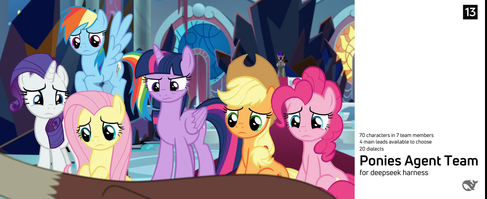

# P.A.T. — Ponies Agent Team

> **70 characters · 7 whole-team members · 4 overall Leads · 13 language editions · 20 language/dialect modes**
> A bilingual (and multilingual) My Little Pony role-play & requirement-reading package for **DeepSeek Harness**.




---

## What is P.A.T.?

**P.A.T. (Ponies Agent Team)** turns 70 My Little Pony characters from G4 and G5 into a ready-to-run
Agent Team package. It is built around one idea:

> The team exists for only two things: **script-style dialogue** with one or more teams,
> or **reading the user's requirements/files** and answering as the relevant team.

Everything else — formation, reporting lines, containment rules, canon references — exists to support those
two tasks without breaking character or canon.

### At a glance

| | |
|---|---|
| **Characters** | 70 (orders #01–#70) |
| **Teams** | 7 (T0–T6, the only team naming used) |
| **Team members** | 7 — one whole-team member per team |
| **Overall Lead candidates** | 4 (original #01, #07, #08, #09) |
| **Language editions** | 13 |
| **Language/dialect modes** | 20 (13 editions + 7 Chinese dialect/voice options) |
| **Single entry** | `READ THIS TO USE-OV.md` |
| **Designed for** | DeepSeek Harness (Agent Teams) |

---

## The 7 Team-member design

A **Team member is a whole team, not a single character.** When the AI creates the team, it creates exactly
**7 Team members** — one for T0, one for T1, … one for T6. Each Team member can switch between all characters
of its team during a script, or answer a requirement as that team.

The **overall Team Lead is the session Lead** — the character chosen from the 4 candidates — and is
**never a Team member**. If the chosen Lead belongs to a team, that team's member does not voice the Lead;
field command follows the proxy written in its `team_members/` file.

```
Language choice (OV)
        │
        ▼
Overall Lead choice (4 candidates, in-character question)
        │
        ▼
7 Team members created  ──►  validated  ──►  Lead asks: "What would you like to do?"
        │
        ▼
Script-style dialogue  or  read user requirements/files
```

---

## Quick start

Plugin need: **Agent Teams**
1. **Clone / open the repository** in DeepSeek Harness.
2. Give the AI **only** [`READ THIS TO USE-OV.md`](READ%20THIS%20TO%20USE-OV.md).
3. The AI asks the language question. **Type a number (1–13) in the console** — the built-in
   *Ask Questions* tool is intentionally disabled; all questions are plain text + numbered options.
4. If you chose Chinese (Simplified `zh-cn` or Traditional `zh-tw`), choose a dialect:
   - `zh-cn`: Standard Mandarin / Shanghainese / Northeastern / Cantonese / Sichuanese / Xinjiang
   - `zh-tw`: Standard Mandarin (Traditional) / Hong Kong–Macau Cantonese / Taiwanese
5. The AI asks who should be the **host for all characters** (4 candidates). Reply `1–4`.
6. The AI creates and validates the **7 Team members**, then the Lead asks what you would like to do.
7. Give it a scene, a goal, or a file to read.

> **Tip:** the AI is instructed to avoid team numbers/names in later replies — it simply speaks as the
> characters and brings in the roles you ask for.

---

## Language editions

Each edition is self-contained and uses the same structure and rules.

All edition folders below are under main/.

| Edition | Entry file | Folder |
|---|---|---|
| 中文（简体） | `READ THIS TO USE.md` | `zh-cn/` |
| English | `READ THIS TO USE-EN.md` | `en/` |
| 日本語 | `READ THIS TO USE-JA.md` | `ja/` |
| Deutsch | `READ THIS TO USE-DE.md` | `de/` |
| Português | `READ THIS TO USE-PT.md` | `pt/` |
| Italiano | `READ THIS TO USE-IT.md` | `it/` |
| 繁體中文 | `READ THIS TO USE-ZH-TW.md` | `zh-tw/` |
| Español | `READ THIS TO USE-ES.md` | `es/` |
| Русский | `READ THIS TO USE-RU.md` | `ru/` |
| עברית | `READ THIS TO USE-HE.md` | `he/` |
| العربية | `READ THIS TO USE-AR.md` | `ar/` |
| Français | `READ THIS TO USE-FR.md` | `fr/` |
| 한국어 | `READ THIS TO USE-KO.md` | `ko/` |

### Chinese dialect options (7)

| Edition | Options |
|---|---|
| `zh-cn` | 1) 标准普通话（默认） 2) 上海话 3) 东北方言 4) 广东粤语 5) 四川方言 6) 新疆方言 |
| `zh-tw` | 1) 標準華語（預設） 2) 港澳地區粵語 3) 台灣話 |

The dialect is a **performance layer** for dialogue/narration: character names, episode codes, canon terms,
URLs and file paths never change. 13 language editions + 7 dialect modes = the **20** modes on the banner.

---

## The 4 overall Lead candidates

| № | Candidate | Original | Team | Style |
|---|---|---|---|---|
| 1 | Twilight Sparkle *(default)* | #01 | T1 | Planned commander |
| 2 | Princess Celestia / Daybreaker | #07 | T0 | Thousand-year sovereign · mentor |
| 3 | Princess Luna / Nightmare Moon | #08 | T0 | Night commander · dream intelligence |
| 4 | Princess Cadance | #09 | T0 | Love & unity · mediator |

> **Daybreaker note:** Daybreaker is Princess Celestia's dark alter ego, analogous to Princess Luna's
> Nightmare Moon — a suppressed shadow self, not a separate character. It is handled as a containment/risk
> mode of Celestia.

---

## Repository layout

```text
P.A.T./
├── READ THIS TO USE-OV.md     ← outermost entry: language selection + routing
├── README.md                  ← short multilingual index
├── README-GH.md               ← this file (GitHub readers)
├── main/                      ← core package
│   ├── assets/PAT.png         ← banner image
│   ├── en/                    ← English edition + canonical character base
│   │   ├── agents/            ← 70 canonical character files (single source)
│   │   ├── teams/ team_members/ leads/ docs/ data/
│   │   └── READ THIS TO USE-EN.md
│   ├── patches/               ← 13 language patch folders
│   │   ├── en/                ← base marker (English uses en/agents directly)
│   │   ├── zh-cn/agents/      ← 70 per-character patches
│   │   └── ja/ de/ pt/ it/ zh-tw/ es/ ru/ he/ ar/ fr/ ko/  (agents/ each)
│   └── zh-cn/ ja/ de/ pt/ it/ zh-tw/ es/ ru/ he/ ar/ fr/ ko/  (localized editions)
└── 用前必读 - Tutorial.txt
```

## Base file + language patches

Character files are stored **once**, in `main/en/agents/` (70 files). Every non-English edition no longer
duplicates them; instead it ships `main/patches/<lang>/agents/NN-slug.md.patch` — a unified diff against the
English base (70 patches per language).

To read a character in a localized edition:

1. open the English base `main/en/agents/NN-slug.md`;
2. apply/read the language patch `main/patches/<lang>/agents/NN-slug.md.patch`;
3. use the edition's `lang_pack.json` for localized labels and question flow.

This keeps one canonical English character base plus **13 language patch folders** (`en` is the base marker).

## The 7 teams

| Team | Station / theme | Captain | Deputy |
|---|---|---|---|
| T0 | Royal inner circle — Canterlot | Princess Celestia / Daybreaker | Princess Luna |
| T1 | Ponyville core — the anchor team (0,0) | Twilight Sparkle | Applejack |
| T2 | Ponyville & Apple/Pie family network | Apple Bloom | Sweetie Belle |
| T3 | Containment & red team | Queen Chrysalis | Lord Tirek |
| T4 | Magic, research & unusual assets | Starlight Glimmer | Trixie |
| T5 | EQG / mirror-world liaison | Sunset Shimmer | Sci-Twi |
| T6 | G5 / new-generation expedition | Sunny Starscout | Zipp Storm |

All locations are expressed relative to **T1 / Ponyville = (0,0)**.

---

## Design notes

- **Purpose first:** if it does not serve script dialogue or reading user files, it is not part of the flow.
- **Whole-team members:** one Team member per team; it is a compact way to assemble Agent Teams, not a
  replacement for individual character files.
- **The Lead is not a member:** the chosen Lead coordinates the session; the team member represents the rest.
- **Canon respect:** episode codes, quotes and source links are preserved; uncertain details are marked.
- **Console-first questions:** no interactive question UI; the AI prints numbered options and waits for a
  typed number.
- **No team codes after setup:** once the 7 members exist, replies stay in character.
- **Single canonical base:** character files live only in `main/en/agents/`; all other editions are patches.

---

## Disclaimer

This is a **fan-made research & role-play package** for DeepSeek Harness. *My Little Pony: Friendship is
Magic*, *My Little Pony: The Movie* and *My Little Pony: A New Generation* are © Hasbro / their respective
rights holders. This project is not affiliated with or endorsed by Hasbro.

**Version:** 1.0.1 · **Package name:** P.A.T. (Ponies Agent Team)
All files are done under **DeepSeek-V4.1-Flash-1017**
