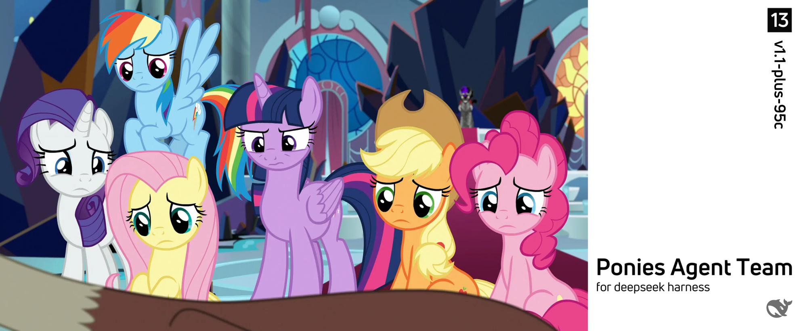

# 🦄 Ponies Agent Team (P.A.T.) — `v1.1-plus-95c`

**A portable My Little Pony roleplay dataset + Agent-Team bootstrap kit.**

95 complete character profiles from **G4 (*Friendship is Magic*, including *Equestria Girls*) and
G5 (*Make Your Mark* / *Tell Your Tale*)** — randomly split into **7 equal-sized volume teams
(T0–T6)**, packaged with an operator flow (`RUN.md`) that turns any AI session into a coordinated
MLP roleplay team, with **19 language/dialect patches** and **7 selectable global Leads**.


<!-- ============================================================================
  IMAGE PLACEHOLDER — replace the banner with your own artwork.
  • File:   ./assets/cover.png   (current: generated placeholder, 1280×640)
  • To change: overwrite assets/cover.png (same filename) — README needs no edit;
    or edit the Markdown image line below to point to a new file in ./assets/.
  • Recommended: 1280×640 (2:1) or 1600×800, PNG/WebP/JPG, < 1 MB.
============================================================================ -->


---

## Table of contents

- [Overview](#overview)
- [Why "volumes"?](#why-volumes)
- [Quick start](#quick-start)
- [Package layout](#package-layout)
- [Character coverage](#character-coverage)
- [Teams T0–T6](#teams-t0t6)
- [Language / dialect patches (19)](#language--dialect-patches-19)
- [Global Lead options (7)](#global-lead-options-7)
- [Character data format](#character-data-format)
- [Verification](#verification)
- [Updating the banner image](#updating-the-banner-image)
- [Versioning & sibling package](#versioning--sibling-package)
- [FAQ](#faq)
- [Fan-content notice](#fan-content-notice)
- [中文说明](#中文说明)
- [Generated by](#-generated-by)

---

## Overview

**Ponies Agent Team (P.A.T.)** is a **data package for AI roleplay sessions**: 95 characters, each documented with
17 complete personal-characteristic fields (appearance, personality, abilities, relationships,
biography, speech style, quotes and more). The characters are split into seven roughly equal
"volume" teams that an Agent-Teams-capable AI can instantiate as seven persistent members
(**T0–T6**) plus one global Lead.

The package is designed for **cross-session portability**: another AI session only needs to read
`RUN.md`, follow its four steps, and it will reproduce the same team, the same data, and the same
user experience — like the volumes of a split archive that reassemble into one file.

- **No Ask-Questions dependency** — every prompt in `RUN.md` is plain chat text (this is a hard rule
  of the flow).
- **No canonical grouping imposed** — team assignment is fully random; canon teams (Mane Six,
  Cutie Mark Crusaders, Young Six, Dazzlings, Apple family, …) can be re-composed across volumes at
  runtime.
- **Language-patch architecture** — the master data is American English; 19 language/dialect
  variants are applied at runtime, and the data files are never rewritten.

## Why "volumes"?

95 characters do not fit comfortably into a single agent context. Like software split into volume
archives, the dataset is stored in **7 parts** (13–14 characters each) so that seven members can
each hold one part. For the user, this is an implementation detail: **all 95 characters live in one
logical container**. The Lead routes questions to the member holding the character and can pull any
characters together into a temporary squad.

## Quick start

Read **`RUN.md`** — it is the complete operator guide. In short:

| Step | Action | Output |
| --- | --- | --- |
| 一 / 1 | Ask the user to pick a language/dialect patch (19 options, plain text) | one choice |
| 二 / 2 | Ask the user to pick the global main Lead (7 options, plain text) | one choice |
| 三 / 3 | Create 7 Team members T0–T6 from `data/T*.md`, then verify every roster against `manifest.json` | verification table (all PASS) |
| 四 / 4 | Send one short closing line and wait for the user's request | session ready |

## Package layout

```text
ponies-agent-team-v1.1-plus-95c/
├── README.md            ← this file (GitHub landing page)
├── RUN.md               ← operator flow for AI sessions (4 steps)
├── TEAMS.md             ← team status: 7 volumes, counts, full rosters
├── manifest.json        ← machine-readable authority (teams, languages, leads, checksums)
├── VERIFICATION.md      ← automated integrity report
├── data/
│   ├── T0.md            ← volume T0 — 14 complete character profiles
│   ├── T1.md            ← volume T1 — 14
│   ├── T2.md            ← volume T2 — 14
│   ├── T3.md            ← volume T3 — 13
│   ├── T4.md            ← volume T4 — 14
│   ├── T5.md            ← volume T5 — 13
│   └── T6.md            ← volume T6 — 13
└── assets/
    └── cover.png        ← banner placeholder (replaceable)
```

## Character coverage

| Series | Count | Notes |
| --- | --- | --- |
| G4 / *Equestria Girls* | 84 | Pony characters incl. EG human-world counterparts; Daybreaker, Nightmare Moon and Midnight Sparkle covered as alternate forms |
| G5 | 11 | *Make Your Mark* / *Tell Your Tale* |
| **Total** | **95** | 17 fields per character |

The full randomized roster is listed in [`TEAMS.md`](./TEAMS.md).

## Teams T0–T6

Team membership is **completely random** (no thematic grouping); sizes are as equal as possible.

| Team | Characters | Data file |
| --- | ---: | --- |
| T0 | 14 | [`data/T0.md`](./data/T0.md) |
| T1 | 14 | [`data/T1.md`](./data/T1.md) |
| T2 | 14 | [`data/T2.md`](./data/T2.md) |
| T3 | 13 | [`data/T3.md`](./data/T3.md) |
| T4 | 14 | [`data/T4.md`](./data/T4.md) |
| T5 | 13 | [`data/T5.md`](./data/T5.md) |
| T6 | 13 | [`data/T6.md`](./data/T6.md) |
| **Total** | **95** | |

## Language / dialect patches (19)

The master data language is **American English**. The user picks one patch at session start; the
AI then conducts the whole session in it (the data files stay English).

| # | Language / dialect | Notes |
| ---: | --- | --- |
| 1 | 简体中文 · 上海话 (Shanghainese) | Simplified script, dialect flavour |
| 2 | 简体中文 · 广东粤语 (Cantonese, Guangdong) | Simplified script, dialect flavour |
| 3 | 简体中文 · 东北话 (Northeastern Mandarin) | Simplified script, dialect flavour |
| 4 | 简体中文 · 四川话 (Sichuanese) | Simplified script, dialect flavour |
| 5 | 简体中文 · 新疆话 (Xinjiang Mandarin) | Simplified script, dialect flavour |
| 6 | 简体中文 · 普通话 (Standard Mandarin) | Simplified script |
| 7 | 繁体中文 · 港澳粤语 (Cantonese, HK/Macau) | Traditional script, dialect flavour |
| 8 | 繁体中文 · 台湾话 (Taiwanese Mandarin) | Traditional script, dialect flavour |
| 9 | 英语 · 美式英语 (American English) | **master / base** |
| 10 | 英语 · 英式英语 (British English) | — |
| 11 | 法语 (French) | — |
| 12 | 德语 (German) | — |
| 13 | 意大利语 (Italian) | — |
| 14 | 西班牙语 (Spanish) | — |
| 15 | 葡萄牙语 (Portuguese) | — |
| 16 | 日语 (Japanese) | — |
| 17 | 韩语 (Korean) | — |
| 18 | 阿拉伯语 (Arabic) | — |
| 19 | 希伯来语 (Hebrew) | — |

Patches work by **translation on top of the English master**; official localized MLP names are used
where they exist, with the English original in parentheses on first mention.

## Global Lead options (7)

The session's narrator/orchestrator persona (a single global Lead, changeable later on request):

1. Princess Cadance
2. Princess Celestia (Daybreaker)
3. Princess Luna (Nightmare Moon)
4. Twilight Sparkle
5. Opaline Arcana
6. Sunny Starscout
7. Sunset Shimmer

## Character data format

Every character is a `## ` section with these fields, in order:

`Series/Continuity` · `Species/Kind` · `Gender` · `Age/Stage` · `Residence` ·
`Occupation/Role/Affiliation` · `Appearance` · `Personality` · `Likes` · `Dislikes` ·
`Fears/Weaknesses` · `Skills/Abilities` · `Family & Relationships` · `Background/Biography` ·
`Speech Style/Catchphrases` · `Notable Quotes` · `Trivia/Notes`

## Verification

`VERIFICATION.md` records the automated integrity checks: 95/95 characters present exactly once,
team partitions matching `manifest.json`, all 17 fields in every profile, G4/EQG + G5 counts,
lite-subset consistency for the sibling package, and archive integrity. `RUN.md` Step 3 repeats a
runtime verification: each member must report its roster, and the union must equal the manifest.

## Updating the banner image

A placeholder banner is included at [`assets/cover.png`](./assets/cover.png) (1280×640, generated
art). To use your own image:

1. Overwrite `assets/cover.png` with a new PNG (same filename) — no README edit needed; **or**
2. Edit the marked `IMAGE PLACEHOLDER` block near the top of this README and point the Markdown
   image at your file (e.g. `./assets/my-banner.webp`).

Recommended size 1280×640 (2:1) or 1600×800, file size < 1 MB.

## Versioning & sibling package

| Package | Characters | Teams | Languages | Leads | Use when |
| --- | ---: | ---: | ---: | ---: | --- |
| **v1.1-plus-95c** (this) | 95 | 7 (T0–T6) | 19 | 7 | Full roster, maximum coverage |
| `v1.1-lite-18c` | 18 | 2 (T0–T1) | 9 | 5 | Small context / quick sessions |

The lite edition is derived from this dataset (a subset of the 95 characters) and uses the same
`RUN.md` flow, data format and verification.

## FAQ

**Does this work without Agent Teams?** Yes — `RUN.md` includes a fallback for platforms without
member/subagent creation: load all seven volume files into one context and verify against
`manifest.json`.

**Is the data translated?** The stored master data is American English only. Translations are
produced at runtime by the chosen language patch; this keeps one canonical source and avoids drift.

**May I edit team assignment?** Yes. Edit `manifest.json` (and store headings accordingly) and update
`TEAMS.md`/`VERIFICATION.md`; the flow reads `manifest.json` as authority.

**Why are some character names spelled unusually?** A few names in the original request are kept
verbatim as roster identifiers; canonical English spellings are noted inside the corresponding
profiles (e.g. Opaline Arcana, listed as "Opalina Acrana").

## Fan-content notice

Unofficial, non-commercial **fan project** for roleplay/AI-agent use. *My Little Pony: Friendship is
Magic*, *Equestria Girls*, *My Little Pony: Make Your Mark* and *Tell Your Tale*, and all character
names and related trademarks are © **Hasbro**. This repository is not affiliated with or endorsed
by Hasbro. Character information was compiled from publicly known canon (series, films, specials,
official tie-ins) and is provided as fan reference material only.

---

## 中文说明

**Ponies Agent Team（P.A.T.）— v1.1-plus-95c** 是一个面向 AI 角色扮演会话的《小马宝莉》角色资料包：

- **95 个角色**：G4（含《小马国女孩》/Equestria Girls）84 个 + G5 11 个，每个角色 17 项完整个人特征。
- **7 个无名分卷队伍 T0–T6**：角色随机均分（13–14 人/队），只为分担上下文，逻辑上 95 个角色处于同一个大容器。
- **19 种语言/方言补丁**：以美式英语原版数据为母本，运行时翻译；数据文件本身不翻译。
- **7 位全局主 Lead 可选**：Princess Cadance、Princess Celestia (Daybreaker)、Princess Luna (Nightmare Moon)、Twilight Sparkle、Opaline Arcana、Sunny Starscout、Sunset Shimmer。
- **RUN.md 流程**：一、选择语言/方言 → 二、选择全局主 Lead → 三、按队伍状态创建 T0–T6 并校验角色 → 四、简短收尾并等待用户请求。**全流程禁止使用 Ask Questions 交互控件，一律以纯文本菜单询问。**
- **校验**：`VERIFICATION.md` 记录自动校验结果；`RUN.md` 第三步会在运行时让每个成员回报名单并与 `manifest.json` 比对。
- **图片位置**：README 顶部已预留横幅图片位（`assets/cover.png` 占位图），可直接替换文件或修改注释中的 Markdown 图片行。
- **精简版**：另有 `v1.1-lite-18c`（18 个角色、2 个成员、9 种语言、5 位 Lead）。
- 本项目为非官方、非商业同人资料；《小马宝莉》相关版权归 **Hasbro** 所有。

---

## 🧾 Generated by

**Generated by: DeepSeek Harness — `deepseek-flash` AI model.**
Character data, team randomization, `RUN.md`, this `README.md`, `manifest.json`, `TEAMS.md`,
`VERIFICATION.md` and the placeholder banner were produced by **DeepSeek Harness (deepseek-flash)**
on **2026-10-24 (Asia/Shanghai)**, with the 95 character profiles compiled in parallel by seven
data-volume Agent Team members (T0–T6), each also running deepseek-flash. My Little Pony characters
and related marks © Hasbro; this is an unofficial fan package.
